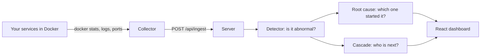

# Evaluation guide: read this in one hour

Everything you need to present and defend the project. Read it top to bottom once (about 60 minutes), run the three commands in section 9, and keep section 8 (questions) for the last ten minutes before you go in.

Suggested split of the three hours: 1 h reading this page, 30 min running the demo and the Python code until you can explain every line, 30 min on the questions, the rest as buffer.

---

## 1. The project in one minute

Companies run many small services (microservices) that call each other. When one breaks, the services that call it start failing too, and the alarm screen lights up everywhere. Finding the one that started it is slow.

**Microservice Mapper** is a tool that sits beside those services and does four things:

1. **Collects** live numbers from each service (CPU, memory, network, request rate, errors, latency, container state) without changing the services.
2. **Learns what is normal** for each service from its own recent past.
3. **Detects** when a service behaves abnormally and **ranks the likely root cause** (the service that started the failure, not the ones suffering from it).
4. **Predicts the spread**: which healthy services are likely to fail next because they depend on a broken one.

How we know it works: a separate fault injector breaks services on purpose and keeps a private answer key. The mapper never sees the key. Afterwards we compare what the mapper said with the key.

---

## 2. Architecture



| Part | Folder | Language | Job |
|---|---|---|---|
| Collector | `remote-collector/` | TypeScript | Reads Docker every 5 s and posts the numbers to the server |
| Server | `server/` | TypeScript (Express) | Stores graph and history, runs the logic every cycle, serves the API |
| Dashboard | `client/` | React + Vite, 3D with three.js | Shows the map, incidents, cascade risk |
| Decision logic | `server/algorithms/` | TypeScript | The real detector, root cause, cascade (used by the server) |
| **Algorithms, every file in Python** | **`algorithms/`** | **Python** | **One simplified `.py` per TypeScript file, plus a Markdown page per area. Start with `algorithms/README.md`** |
| **Core logic (explain this)** | **`core_logic/`** | **Python** | **The same ideas in about 300 readable lines, with a demo and tests** |
| Graphs and reports | `graphs/` | TypeScript | Builds the model lab page and the evaluation report |
| Running, testing | `run/` | TS / JS | Start scripts, tests, evaluation and learning commands, recorded sample runs |
| Documentation | `wiki/` | Markdown | This guide and the detailed chapters |
| Not used right now | `unused/` | | Old experiments kept for reference |

If an evaluator opens the logic, open `core_logic/`. It is Python, uses only the standard library, and is short.

---

## 3. Where the data goes

1. The **collector** reads Docker every 5 seconds: CPU, memory, network counters, throttling, container state, restarts, and the new log lines (request count, errors, latency). It also reads `/proc/net/tcp` inside containers to see who talks to whom.
2. It posts one batch to the server (`/api/ingest`).
3. The server merges it into the **graph** (services and who calls whom) and into the **metric history**: the last 720 readings per service (about an hour), kept in memory and saved to `server/data/telemetry_db.json`.
4. Every cycle the **detector** reads that history, the **root cause** step reads the detector's findings and the graph, and the **cascade** step reads both.
5. The dashboard asks the server for the result.

Saved files, all under `server/data/` (not in git, created when you run it): `graph_db.json` (services and links), `telemetry_db.json` (history), `models/<project>.json` (per-project baseline model), `remote_config.json` (saved projects), `incident_thresholds.json` (rule edits).

---

## 4. The three algorithms

You can run all of this: `python core_logic/demo.py`.

### 4.1 Detector: is this service abnormal? (`core_logic/detector.py`)

Idea: compare each service with **its own** past. A database at 60% CPU may be normal; a web server at 60% is not.

For one metric (say CPU):

1. **Baseline** = older readings. The newest two are being judged and never go into the baseline.
2. **Centre** = the **median** of the baseline. **Spread** = the **MAD** (median absolute deviation) times 1.4826, which turns it into a standard-deviation-like number.
3. **Score** = how many spreads the newest reading sits from the centre, counted only in the bad direction (CPU, latency, errors going up; request rate going down).
4. **Persistence**: both of the last two readings must score above **3.5**. One odd reading is noise.

Extra safeguards (each has a reason you can quote):

| Safeguard | Why |
|---|---|
| Median and MAD, not mean and standard deviation | One huge spike drags the mean and hides the next one. The median barely moves. |
| Log scale for rates and latencies | Compare by ratio: 100 ms to 200 ms is the same jump as 1 s to 2 s. |
| Self-healing baseline | Old stretches that were already abnormal are removed, so a long outage never becomes "normal". |
| Noise control | A series that is jumpy even when healthy is turned down so it does not cry wolf. |
| Minimum 12 readings of history | A service that just started is not judged. Cold start says nothing rather than guesses. |
| At least 5 requests for latency / error share | A p95 from two requests is meaningless. |
| Missing reading = unknown, never 0 | Zero would look like a collapse. |
| Silence rule | A service that normally gets traffic and suddenly gets none is frozen or dead, even though nothing "spiked". |

Worked example: CPU readings hover around 10 (9.3 to 10.7). Two new readings of 25 and 30 get scores 5.9 and 7.0, so CPU is flagged (HIGH). Readings of 11.0 and 11.2 get 0.5 and 0.7: normal.

Hard facts skip the statistics: a stopped, paused or crash-looping container is evidence by itself.

### 4.2 Root cause: which service started it? (`core_logic/root_cause.py`)

Failures travel **against** the direction of calls. If `checkout` calls `payments` and payments breaks, checkout starts failing. So when two connected services are both unhealthy, the one being called is the better suspect.

Per service:

- **own** = strongest abnormal score of things about itself (CPU, memory)
- **symptom** = strongest abnormal score of things it can inherit (latency, errors, traffic drop)
- **explained** = how bad the services **it calls** are (they excuse its symptoms)
- **hard** = container is stopped/paused/crash-looping

```
score = max(own,  symptom - explained)  +  100 if hard
```

Then: a small bonus for services that many other troubled services depend on, and the current verdict is kept unless another service beats it by 15% (so the answer does not flicker). Highest score wins. Confidence is HIGH if the winner is far ahead or is the only stopped container, MEDIUM if clearly ahead, LOW otherwise.

Worked example (the demo): `payments` has traffic collapse (23.5) and latency (22.1). `web`, which calls payments, has errors 17.5 and latency 19.9. web's symptom minus what payments explains is below zero, so web scores 0 and **payments** is ranked first, with HIGH confidence.

Special cases: a service with no data at all can be named if at least two of its callers show symptoms nothing else explains (blind spot). If most services go silent in the same moment, we report a **monitoring outage** and blame nobody. If the host itself stopped reporting, we blame no service.

### 4.3 Cascade: who is next? (`core_logic/cascade.py`)

Each service gets a starting failure probability `p0`: stopped = 1.0, degraded = 0.5, abnormal evidence adds up to 0.8. Risk then flows from callee to caller:

```
P(service) = 1 - (1 - p0) x  product over each callee c of  (1 - 0.7 x weight x P(c))
```

Read it as: the service survives only if it survives on its own **and** survives every dependency. The 0.7 (`TRANSMISSION`) is below 1 because retries, timeouts and caches stop some failures from spreading.

Worked example: `web -> api -> db`, db stopped (P = 1). api: 1 - (1 - 0.7) = **0.70**. web: 0.7 x 0.7 = **0.49**. Services that look fine themselves but get P above 0.15 are listed as **at risk**.

Because services can call each other in loops, the formula is repeated until the numbers stop changing (at most 200 rounds). The same function powers "what if service X failed?": start from a healthy system, set X to failed, read the result.

Be honest about this one: the 0.7 and the weights are modelling choices, not measured frequencies. The tool says so on screen.

---

## 5. How the Python maps to the real code

| Python (`core_logic/`) | TypeScript (real system) |
|---|---|
| `detector.py` `abnormal_scores`, `detect_service` | `server/algorithms/detection/AnomalyDetector.ts` |
| `settings.py` | `DETECTOR_PARAMS`, `server/algorithms/detection/thresholds.ts` |
| `root_cause.py` `rank_root_causes` | `server/algorithms/rca/RCAEngine.ts` |
| `cascade.py` `predict_cascade`, `what_if` | `server/algorithms/graph/CascadeEngine.ts` |

What the TypeScript adds on top: container facts straight from Docker, CPU-throttling signal, weights for each link depending on how it was discovered, a per-project learned baseline, cleaner silence rules for sparse traffic, and plain-language explanations. The core is what you read in Python.

---

## 6. Learning and results (be honest here)

**Method.** We recorded two systems (ShopFlow and LedgerLine) for 217 minutes with 34 injected faults of six kinds (stopped container, crash, crash-loop, memory pressure, CPU brownout, paused). The injector's answer key is kept apart from what the mapper showed.

We compared four ways of deciding:

| Method | Meaning |
|---|---|
| Live mapper | The running system's rules, exactly as recorded |
| Rules, fixed threshold | Same rules re-scored with threshold 3 |
| Rules, tuned threshold | Same rules with the threshold chosen on training data |
| Learned model | Logistic regression over 18 features, trained on the labelled faults |

Evaluation is blocked by time (each run cut into 5 consecutive chunks, train on some, test on the others, never shuffled) and also across systems (train on one, test on the other).

**Results** (34 faults, tested on data not used for training):

| Method | Faults detected | Right service first (of detected) | False alarms per hour |
|---|---|---|---|
| **Live mapper (rules)** | **97%** (33/34) | **58%** (19/33) | **0.0** |
| Rules, fixed threshold | 97% | 55% | 8.9 |
| Rules, tuned threshold | 82% | 46% | 4.4 |
| Learned model | 50% | 53% | 3.0 |

**Conclusion we drew:** the learned model is **not** better than the rules on this data, so the product keeps the rules and the learned weights are **not installed**. We report this instead of hiding it. The learned model mostly lost on detection: with only 34 faults, a few strongly related features (own, cpu) made the weights unstable. More labelled faults are needed before a learned model is worth switching on.

What does learn in the product: each project builds its own baseline model during its first 30 minutes (the "learning period") and retrains every 5 minutes, excluding incident periods. During that period only hard container facts can raise an incident.

The full chart set (data skew, features, weights, curves, sliding-window sensitivity) is `graphs/output/model-lab.html`. Open it in a browser; every chart has a grey box saying what both axes mean.

Limits to state yourself before they ask: 34 faults is a small sample; two benches; the last held-out campaign on the final code was not re-run in this environment; thresholds were tuned on this data; "right service first" is about 58%, not 100%, mostly when several faults overlap in time.

---

## 7. Demo script (5 minutes)

1. `npm start`, open http://localhost:5173. Show the 3D map: colour is state, links are calls.
2. Point at a running project (or the sample). Open **Incidents**: the hero card names the root cause, confidence, and shows why (own, symptom, explained away).
3. Open **Cascade risk**: probabilities per service, "what if this fails", at-risk list.
4. Show `core_logic/demo.py` output: the same three steps in text.
5. Open `graphs/output/model-lab.html`: scroll to section 4 (comparison) and say the conclusion in section 6 above.

---

## 8. Likely questions

**Why not a fixed threshold like CPU above 80%?** Normal differs per service; a fixed line misses abnormal-for-this-service and fires on always-busy ones. We compare with the service's own past. (There is also an absolute limit at 85% as a safety net.)

**Why median and MAD?** Robust to outliers. One spike changes the mean and the standard deviation a lot, so the next spike would look smaller. Median and MAD barely move.

**Why two readings in a row?** One reading is usually noise; two is a trend. Cost: one reading (about 5 s) of delay.

**Why log scale?** Latencies and rates are skewed: a few huge values. Ratios (double, half) are symmetric and comparable between services.

**What if an outage lasts a long time?** The baseline drops stretches that were already abnormal, so it never adopts the outage as normal.

**How do you tell the cause from the victims?** Failures travel from the called service to its callers. A caller's symptoms are discounted by how broken its callees are. The root cause is the service whose evidence is not explained by anything it depends on.

**What if the cause is a service with no telemetry?** Blind-spot rule: if two or more of its callers show symptoms nothing else explains, it is named, with a lower score.

**What if everything goes silent at once?** Monitoring outage, no one is blamed.

**What does the 0.7 mean?** The share of a dependency's failure that reaches its caller. It is below 1 because of retries and timeouts. It is a stated assumption; changing it changes the probabilities but not the order much.

**Is the cascade prediction validated?** No. It is a model with stated parameters, not calibrated against recorded cascades. The tool labels it as an estimate. Validated is the detection and the root-cause ranking (the table in section 6).

**How did you test it?** A fault injector breaks services on purpose and keeps a private answer key; the mapper never sees it. Scores come from comparing the two.

**Why isn't the machine-learning model used?** We trained and tested it fairly, it was not better than the rules on our data (section 6), so we kept the simpler, explainable rules. The pipeline is there to retest when there is more data.

**How do you avoid false alarms?** Per-service baselines, persistence of two readings, noise control for jumpy series, minimum request counts, no judging in the first 30 minutes of a new project, and a learning period before soft evidence counts.

**What is the false alarm rate?** 0.0 per hour for the live system on the recorded runs; 3 to 9 per hour for the re-scored variants. Mention the sample is small.

**How is it different from Prometheus or Datadog?** Those show metrics and need alert rules written by a person. This learns normal per service, ranks the cause, and predicts spread from the call graph, with no code changes.

**Why is it written in TypeScript and not Python?** The product is a web application: the dashboard must be JavaScript, so using TypeScript for the server and collector too gives one language and one set of data types (service, link, incident) that every part checks against. The logic runs every 5 seconds inside the live server, so keeping it in the same language avoids running a second program and passing data to it. Docker, SSH and WebSocket libraries are strong in Node. The same files are reused by the tests and the scoring tools. The maths itself is language independent, and every file has a simplified Python version in `algorithms/`. Python is used where it is the better tool: the machine learning experiments in `ml/`.

**What are the limits?** Only Docker so far, small test set, overlapping faults confuse the ranking, the cascade weights are assumptions.

**What would you do next?** Collect many more labelled faults, retest the learned model, calibrate the cascade against recorded cascades, support Kubernetes.

---

## 9. Commands

```bash
git clone <repo-url> && cd microservice-mapper
npm start                          # installs what is missing, starts server (:3001) and dashboard (:5173)
python3 core_logic/demo.py         # the logic on a small made-up shop
python3 core_logic/test_core_logic.py
python3 algorithms/run_all_tests.py   # tests for every Python algorithm file
npm test                           # the TypeScript tests
npm run ml                         # compares rules and learned model on the recorded runs
npm run ml:report                  # rebuilds graphs/output/model-lab.html
```

The Python commands need only Python 3. The npm commands need the dependencies once: `npm start` installs them on its first run, or run `npm run install:all` by hand.

`npm run local` additionally starts a collector for every Docker Compose project running on your machine.

---

## 10. Folder map

```
algorithms/   every algorithm as simple Python + a Markdown page per area (explain these)
core_logic/   just the three core steps in Python, with a demo
graphs/       report builders and the generated model lab page (graphs/output)
run/          start scripts, tests (run/tests), CLIs (run/cli), sample recorded runs (run/recorded-runs)
wiki/         documentation; this page is the short path
server/       the backend; the real TypeScript logic is in server/algorithms/
client/ remote-collector/ traffic-gen/ ml/    the other applications
unused/       old material, not part of the running system
```
