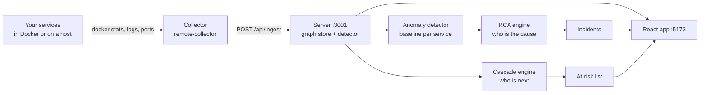
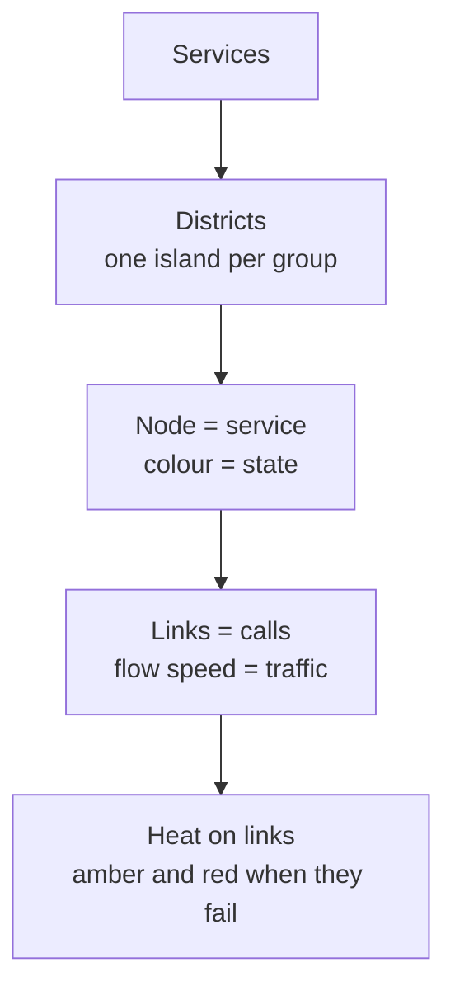
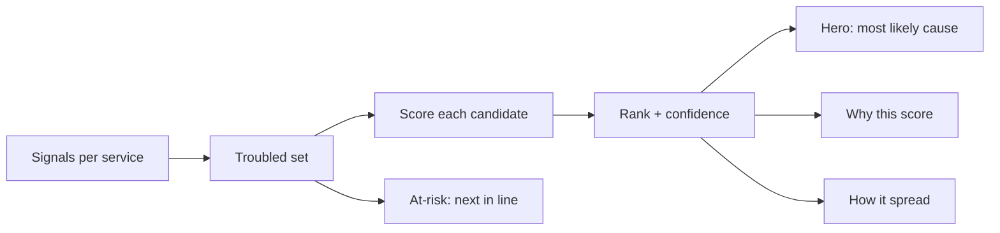

# How each page of the app works

The mapper is an observability tool. Your services run on their own; the mapper watches them, learns what normal looks like for each one, and tells you when something is wrong, what probably caused it, and what is next in line. This chapter walks through every page: what it shows, where the data comes from, and what you should read from it.

## The data path, once

Every page below reads from the same server. Nothing on a page is computed in the browser except layout.

## Page map

| Group | Page (sidebar name) | Question it answers | Main endpoints |
|---|---|---|---|
| Now | **Incidents & cascade** | What is broken, what caused it, what is next? | `/api/rca/incidents`, `/api/rca/risk` |
| Now | **Cascade risk** | What is likely to fail next, what is exposed, and what happens if a given service fails? | `/api/reliability/cascade`, `/api/reliability/whatif/:id` |
| Now | **Spatial view** | What does my system look like right now? | `/api/graph`, `/api/rca/*`, `/api/live` |
| Now | **Architecture** | How are my services wired? | `/api/graph` |
| Investigate | **Telemetry** | What are the raw numbers for one service? | `/api/metrics`, `/api/logs` |
| Investigate | **Traces** | Which requests crossed which services, and how slow? | `/api/traces` |
| Investigate | **Dependencies** | Who calls whom, with what error rate and latency? | `/api/graph` (edges) |
| Investigate | **Analytics** | How did things trend over time? | `/api/metrics/history` |
| Research (hidden by default) | Experiments, Model findings, ML pipeline | How good is the model? | `/api/ml/*`, `/api/experiments` |

The sidebar can be collapsed, and the Research group appears only when you press "Show research tools".

## Top bar and shared controls

- **Project picker.** One mapper can hold several systems. Picking one scopes every page and every count to it.
- **Add project.** Registers a target, either a Docker host the collector pushes from or an SSH host the server discovers.
- **Traffic panel.** Shows whether the project's traffic generator is running and lets you start or stop it (benches only).
- **Terminal.** A shell into the target for quick checks; it never changes what the mapper learns.
- **Status counts.** Healthy, degraded, down, for the selected project only.

## Cascade risk

The prediction page, available even when nothing is wrong. It answers three questions in order: what is likely to fail next (the cascade model's probability for every service and the path it travels), what is exposed right now and why (a risk ranking with each factor), and what if this service failed (a what-if simulation of the blast radius). All numbers are model estimates and are labelled with the model's parameters; they are not observed frequencies. With the system healthy every probability is near zero.

## Spatial view (the default page)

- **Islands** group related services. Island tints are decoration only.
- **Colour means state.** Healthy is calm, amber is degraded, red is failing. Warm colours appear nowhere else, so any warm colour is something to look at.
- **Links** carry moving particles: speed follows traffic, and the link heats up when its error rate or p95 latency crosses the thresholds (amber at 1 percent errors or 300 ms, red at 5 percent or 1000 ms).
- **Live overview card.** Counts, the top incident and chips for services in trouble. It can be minimised with the arrow; the choice is remembered.
- **Callouts.** Click a service to see state, CPU, memory, error rate, p95 and its callers and callees.
- **Layouts.** Switch between the district layout and a flat layout from the toolbar.

Read it as a map: find the warm colour, follow the link towards its callers, and open **Incidents** for the explanation.

## Incidents

This is the page you open when something is wrong.

| Section | What it tells you |
|---|---|
| **Cascade** | A full-width strip under the hero: the source, the services already affected (observed), and the services next in line with a predicted probability and the dependency it travels through. |
| **Hero** | The most likely root cause, confidence, when it started and how long it has lasted. |
| **Ranking** | Every candidate with its score. A close second place means the answer is not settled. |
| **Why this score** | The evidence behind the number: its own anomaly, how much of the trouble it explains downstream, hard signals such as a crash or a stopped container. |
| **How it spread** | The chain from the cause to the services that suffer because of it. Failure travels against call arrows: if A calls B and B fails, A feels it. |
| **At risk** | Healthy services that depend on troubled ones, with a probability. These are warnings, not incidents. |
| **Next steps** | Suggested checks for the top cause. |
| **Evidence** | The raw signals (z-scores, error rates, restarts) that fed the decision. |
| **Rules** | The thresholds in force. They can be tuned and are saved by the server. |

How to read it: trust a high-confidence hero; for a low-confidence one, check the second candidate and the "how it spread" chain before acting. A **monitoring outage** banner means the collector went silent, so the services are not necessarily down.

## Architecture

A static drawing of the discovered graph: nodes are services, arrows are "A calls B". Direction comes from which side listens on the port. Edge confidence (how sure the mapper is that the link exists) is shown by line style: solid is observed, dashed is only declared in configuration. Use it to review structure, not health.

## Dependencies

A table and 2D graph of every link with request rate, error rate, p95 latency and its health status. Sort by error rate to find the unhealthy link even when both ends look fine.

## Telemetry

Pick a service to see CPU, memory, network and its latest logs. Values that could not be measured show as a dash, never as zero. Absolute limits are flagged: CPU or memory above 85 percent of the container limit.

## Traces

Request paths that crossed several services, with per-hop duration. Use it to see where a slow request spent its time. Services without tracing show no spans here, which does not mean they are idle.

## Analytics

Time-series for the selected service or the whole project: request rate, error rate, latency percentiles and resource use, with the incident windows shaded. Use it to see whether a problem started suddenly or crept in.

## Research pages (hidden by default)

| Page | Purpose |
|---|---|
| **Experiments** | Runs of the offline model comparisons. |
| **Model findings** | Results and charts from those runs. |
| **ML pipeline** | Training and inference status of the Python model. |

These are for developing the mapper, not for operating a system. A DevOps engineer does not need them day to day.

## What the mapper never does

- It does not install anything inside your services.
- It does not know about the fault injector. When you test with the benches, the injector keeps a private ledger and the mapper only sees symptoms.
- It does not guess a number it cannot measure: unmeasured is shown as unknown.

## ML scores are off by default

The Isolation Forest scorer (research) is not used by the product unless the server is started with `MAPPER_ML=1`. Trained on little data it called a quiet, healthy system "100% anomalous", which showed up as ML-flagged tags, red services and at-risk counts with no traffic and no fault. Incidents, root cause and cascade risk come from the statistical detector.
