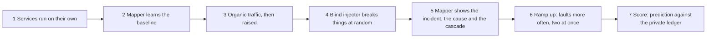

# Experiment report: how the mapper is tested, and what it scored

**[Open the full report with charts](experiment-report.html)** (generated by `npm run demo`, or by `npm run eval -- all --subject shopflow`).

## The experiment in seven steps

The benches (ShopFlow, LedgerLine) and the mapper are separate projects. The injector writes every fault it applies to a private ledger on its own host. The mapper never reads it. The evaluator reads the ledger only after the run and compares it with what the mapper said, using the mapper's public API alone.

Run it on one machine: start the mapper (`npm run local`), then `npm run demo -- --bench ../bench-1 --subject shopflow`.

## What is measured

| Measure | Question it answers |
|---|---|
| Detection rate, time to notice | Did an incident appear, and how fast? |
| Root cause Top-1, Top-3, MRR | Was the injected service named first, or within three? Settled ranking and first ranking are both reported. |
| Kind of fault recovered | Is the evidence the mapper holds on the service it blames the evidence that kind of fault leaves (down, frozen, slow, memory, isolated)? Accuracy and Cohen's kappa. |
| Cascade precision and recall | Against what depends on the root (structural), and against what actually went unhealthy (observed). |
| At-risk calibration | Brier score, expected calibration error, AUC, reliability diagram. |
| False alarms | Incident time outside every fault window, per hour. |
| User impact | From the traffic generator's own log, for faults that ran alone. |

## Statistics reported

Wilson and bootstrap 95% intervals, 5-fold stratified cross-validation of the accuracy estimate (the rules are fixed, so this shows stability and is not model selection), a one-sided binomial test against picking a candidate at random, skewness and excess kurtosis of the detection delay, and Spearman correlation between fault duration and delay. Resampling is seeded, so the same inputs give the same numbers.

## Honest limits

- Intervals are wide when the campaign is short. Read the whiskers.
- Overlapping faults make a single "right answer" ambiguous, so isolated and overlapping faults are reported separately.
- The kind-of-fault check reads the mapper's own anomaly records; it is a consistency check, not a second detector.
- Results from one bench are not results for every system. LedgerLine is the second subject.
