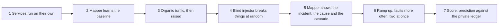

# Experiment report: how the mapper is tested, and what it scored

**[Open the full report with charts](experiment-report.html)** (generated by `npm run demo`, or by `npm run eval -- all --subject shopflow`).

## The experiment in seven steps

The benches (ShopFlow, LedgerLine) and the mapper are separate projects. The injector writes every fault it applies to a private ledger on its own host. The mapper never reads it. The evaluator reads the ledger only after the run and compares it with what the mapper said, using the mapper's public API alone.

Run it on one machine: start the mapper (`npm run local`), then `npm run demo -- --bench ../bench-1 --subject shopflow`.

## What is measured

| Measure | Question it answers |
|---|---|
| Detection rate, time to notice | Did an incident appear, and how fast? |
| Root cause Top-1, Top-3, MRR | Was the injected service named first, or within three? Settled ranking and first ranking are both reported. |
| Kind of fault recovered | Is the evidence the mapper holds on the service it blames the evidence that kind of fault leaves (down, frozen, slow, memory, isolated)? Accuracy and Cohen's kappa. |
| Cascade precision and recall | Against what depends on the root (structural), and against what actually went unhealthy (observed). |
| At-risk calibration | Brier score, expected calibration error, AUC, reliability diagram. |
| False alarms | Incident time outside every fault window, per hour. |
| User impact | From the traffic generator's own log, for faults that ran alone. |

## Which faults count as ground truth

A fault only counts as a root cause to find if it changed something. Crash, stop, crash-loop and pause change the container's state, which is a fact. A softer fault (brownout, flap, memory, partition) counts when users felt it, measured from the traffic generator's own log while the fault ran alone. A soft fault that ran alone, with traffic measured, and that users did not feel is labelled **no measurable effect**. It is left out of the confusion matrices and the report lists it separately, together with whether the mapper reported it anyway. When faults overlap, or no traffic log exists, an effect cannot be ruled out, so the fault stays in.

## Statistics reported

Wilson and bootstrap 95% intervals, 5-fold stratified cross-validation of the accuracy estimate (the rules are fixed, so this shows stability and is not model selection), a one-sided binomial test against picking a candidate at random, skewness and excess kurtosis of the detection delay, and Spearman correlation between fault duration and delay. Resampling is seeded, so the same inputs give the same numbers.

## Runs so far on ShopFlow (one fault at a time, blind injector)

Small samples: read the counts, not just the percentages. Every row is a different version of the mapper, so the rows show how the mapper changed, not noise.

| Run | Mapper version | Faults | Detected | Right service named first (of detected) | False alarms per hour | What the misses were |
|---|---|---|---|---|---|---|
| Stormy (overlapping faults) | rules, first version | 20 | 18 (90%) | 14 of 18 (78%) | not measured | overlapping faults make one right answer ambiguous |
| A | rules, before the sparse-traffic and container-fact fixes | 6 | 5 (83%) | 3 of 5 | 7.6 (learning period included) | both partitions blamed on a caller; one fault never reported |
| B | rules, with the sparse-traffic and container-fact fixes | 8 | 7 (88%) | 4 of 7 | 2.2 (first 8 minutes left out) | brownouts on `inventory`, `catalog-db` and `psp-sandbox`, and a flap on `catalog`, blamed on callers or missed |
| C | learned model (see page 41) | in progress | | | | |

What the runs showed, in order of how much each cost:

1. **Hard container facts are reliable.** Crash, stop, crash-loop and pause were named correctly every time in runs A and B (crash on `api-gateway`, `catalog`, `orders`; pause on `inventory`; crash-loop on `cart`).
2. **Partitions looked like missing data.** A container with no network reports nothing, and the hand-written rules treated that as "unknown", so a caller was blamed. Docker states it as a fact (no network attached), so it is now read as one.
3. **Soft faults on quiet services are the hard case.** A brownout (CPU limit cut) on a service that gets a request every few seconds produces too few requests to see latency. The slowness showed first on a busier caller, which was blamed. The CPU throttling counter from the container runtime is the culprit's own evidence and does not need traffic.
4. **Quiet services were the main source of false alarms**, because three quiet samples are normal for them. Fixed by judging silence against each service's own longest quiet gap.

## Honest limits

- Intervals are wide when the campaign is short. Read the whiskers.
- Overlapping faults make a single "right answer" ambiguous, so isolated and overlapping faults are reported separately.
- The kind-of-fault check reads the mapper's own anomaly records; it is a consistency check, not a second detector.
- Results from one bench are not results for every system. LedgerLine is the second subject.
