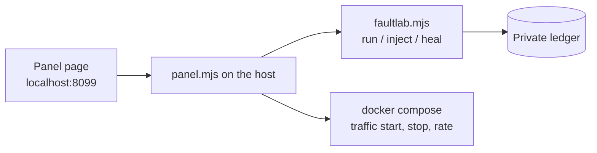

# The fault panel and the staged demo

Two ways to drive a bench without touching the mapper. The mapper is never told what is injected.

## Fault and traffic panel

Runs on the bench host (`lab/faultlab/panel.mjs`, in each bench repo, branch `faultlab`). Listens on `127.0.0.1:8099`; on EC2 reach it through an SSH tunnel (`run/ssh/panel-tunnel.sh`).

| Control | Does |
|---|---|
| Profile, minutes, faults per minute, max at once, seed | Starts a random campaign (reproducible from the seed) |
| Fault types, services | Limits where and how faults may land (none selected means all) |
| Inject by hand | One fault on one service with severity and hold time |
| Heal everything / Stop | Puts every limit back; stopping a campaign heals first |
| Traffic | Start, stop, average requests per second, organic or steady shape |

POST requests need a header the page sets, and the panel binds to localhost, so another site in your browser cannot drive it.

## Staged demo

`npm run demo -- --bench ../bench-1 --subject shopflow` (mapper already running):

1. Baseline: observe normal operation so every service gets its own baseline.
2. Traffic: organic load raised so request rates rise.
3. Calm: random faults, one at a time.
4. Storm: faults more often, up to two at once.
5. Score the mapper's answers against the ledger and write the report to wiki/visualizer/experiment-report.html`.

## What the collector now measures from each service

From the services' own request log lines (JSON `{"msg":"request","status","ms"}` and nginx JSON access lines): request rate, error rate (5xx share), mean and p50/p95/p99 latency. A window with no request lines is a real zero (traffic stopped), not unknown. The collector also sends network bytes per second and restart counts, so a pause, partition, brownout or crash loop each leaves a different fingerprint:

| Fault | What the mapper sees on the culprit |
|---|---|
| crash, stop | container exited or restarting (hard evidence) |
| crash-loop | repeated restarts |
| pause | container paused, silence |
| brownout | latency and errors up, CPU up |
| memory | memory percent climbing |
| partition | request rate and network rate fall to nothing while the container is running |
