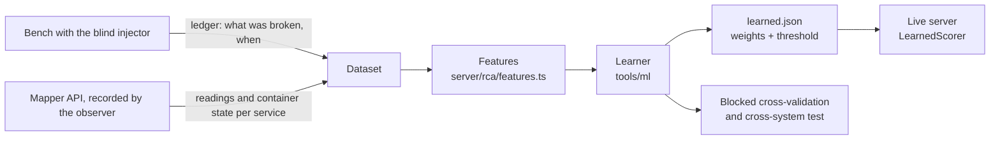
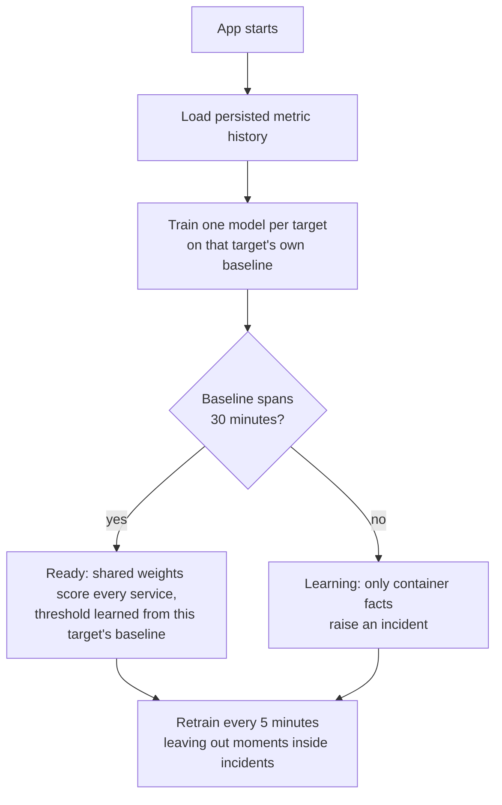

# Learning from labelled faults: what is learned, what is not, and how it is checked

Hand-tuned thresholds are guesses. This page describes how the mapper stops guessing: it learns how much each signal matters from runs where the true cause is known, and it is only trusted on data it was not trained on.



## One model per architecture, trained at every start



Every architecture is a different system, so each target (a bench, a project) gets **its own model**, built when the app starts from the metric history it has collected. The app does not load a model from the last run: it trains afresh, so the model always describes how this system behaves now.

| Step | What happens | Where |
|---|---|---|
| Train | Every moment of the baseline is scored with the shared weights; the alarm threshold is the highest score that held for two cycles in a row while the system was healthy (top 1% trimmed), and never below the threshold learned across systems | `server/rca/TargetModel.ts` (pure) |
| Learning period | Until the baseline spans `MAPPER_BASELINE_MIN` minutes (default 30) the project shows **Learning baseline, N of 30 min**, and only stopped, paused, restarting or network-less containers raise an incident | `IncidentManager`, the top bar, the Incidents page |
| Keep it honest | Moments while an incident was open (plus a minute of recovery) are left out of every retraining, so a fault is never learned as normal | `server/rca/TargetModels.ts` |
| Inspect | `GET /api/models` and `server/data/models/<target>.json`: state, minutes of baseline, scorer, threshold, noise ceiling | |
| Reset | Clearing a project's cached data (project settings, Maintenance) also drops its model; it learns again from new data | |

## What is learned and what is not

| Layer | How it is set | Why |
|---|---|---|
| Per-series normalisation: how far a signal is from that service's own normal (robust z-score, log scale for rates, noise shrinkage) | **No labels needed.** Statistics of the service's own past. | A CPU jump on a busy API and on a quiet database become comparable without anyone choosing a number per service. |
| Container facts (down, paused, restarting, no network) | Read from the runtime. Not learned. | They are facts, not degrees. |
| How much each signal counts, and how the neighbours' state counts (callers suffering, a called service broken) | **Learned** (logistic regression) from labelled runs | This replaces hand-picked weights such as "own evidence beats symptoms" and the fixed bonus for hard facts. |
| The alarm threshold | **Chosen from data** on the training part only | It is the point that best trades faults caught against false alarms. It is not typed in. |
| Regularisation strength | Chosen on the training part only | Keeps the weights stable with few faults. |
| Measurement resolution (the smallest CPU or network step worth noticing, minimum requests before a percentile means anything) | Fixed, from how docker reports | These are units of measurement, not decision thresholds. |

Features (one row per service per collection cycle, computed only from the past): its own CPU, memory and CPU-throttling deviation; drops in network and requests; rises in errors and latency; container facts; and neighbour features (how much the services that call it are suffering, the evidence on the services it calls).

The model is a **logistic regression** on purpose. With a few thousand rows and 18 features, a linear model is stable, trains in milliseconds, and every learned weight can be read: "a paused container pushes the score up by this much". The server shows the top contributing features beside each candidate.

## Why the validation is built the way it is

- **Labels come from the injector's private ledger.** The mapper never saw them. The recorded data is only what its public API showed.
- **Rows are not independent.** Neighbouring seconds of one fault are almost identical, so a random split would leak: the model would be tested on the second half of a fault it trained on. Evaluation is therefore **blocked by time**: the run is cut into K consecutive blocks, the model is trained on the other blocks, and tested on the held-out one. Every fault sits in exactly one block.
- **Scored per fault and per alarm, not per row.** A fault is detected when an alarm (two consecutive cycles above the threshold) names the faulted service, or something that depends on it, among its top three during the fault. Top-1 is the highest-scoring service at the last alarming cycle before the fault ended. False alarms are alarm episodes that overlap no fault, per hour of fault-free time after warm-up.
- **Compared with what the mapper did live.** The hand-written rules are scored on the same held-out blocks, once with their fixed threshold and once with a threshold tuned the same way as the learned model. This separates "learning the weights helped" from "tuning one number helped".
- **Cross-system test.** The model is trained on one bench and tested on the other (ShopFlow to LedgerLine and back). If it only works on the system it was trained on, it memorised that system.

## Running it

```
npm run eval -- observe --subject shopflow --target shopflow     # record, while a campaign runs
npm run ml -- <run-dir> [<run-dir> ...]                            # learn, validate, write server/rca/model/learned.json
```

The server reloads `learned.json` when the file changes. Without the file, or with `MAPPER_LEARNED=0`, it uses the rule-based ranking. If the file does not match the current feature list it is ignored, with a warning in the server log.

## Results

Filled in from the real runs below once they finish (a 60-minute calm campaign and a 25-minute storm on each bench, recorded with the current mapper).

RESULTS_PLACEHOLDER
