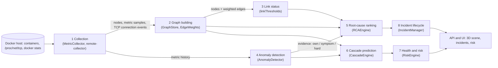
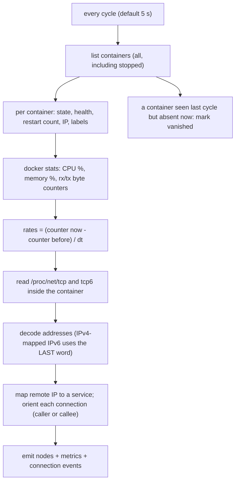
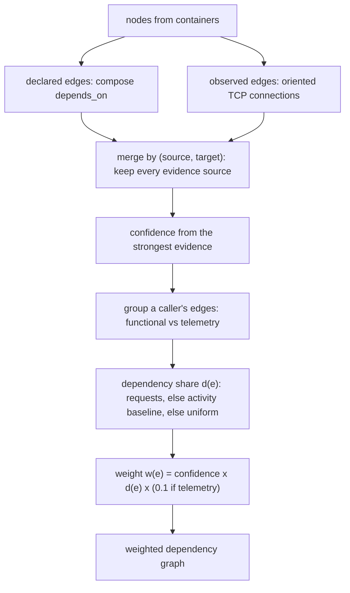
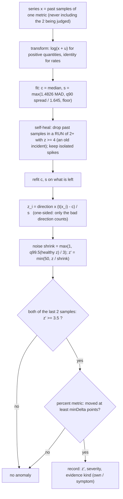
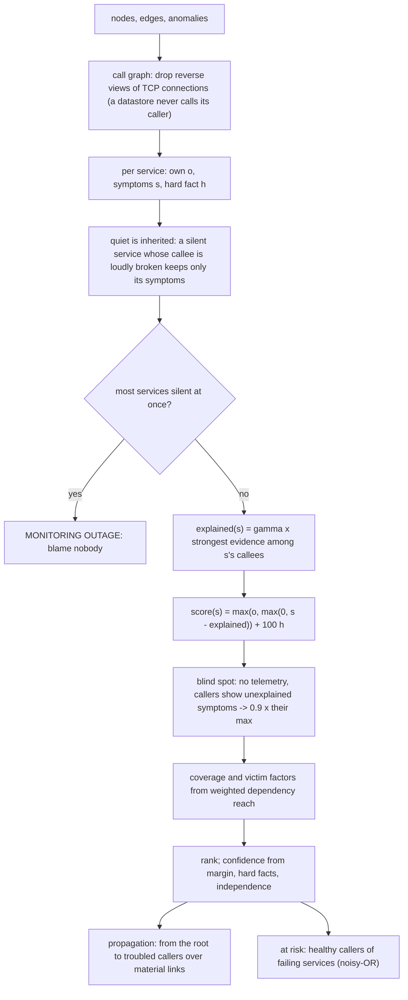
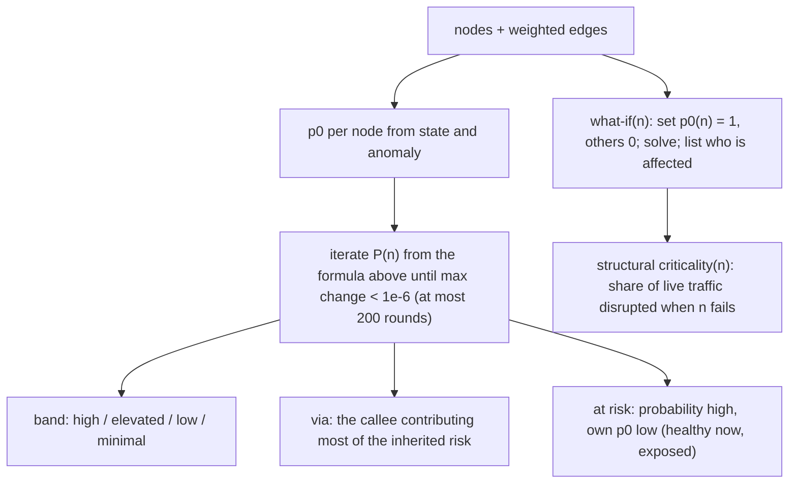

# Mapper algorithms: graph building, root-cause analysis, cascade prediction

What the mapper computes, block by block, with a flowchart, pseudocode, the mathematics and the source file for each. The companion document
[`bench-1/wiki/FAULT_INJECTION.md`](https://github.com/Royson-salis-18/bench-1) describes the machinery that tests it (blind fault injection and organic traffic);
section 9 here says how the two meet.

Contents: [0 Pipeline](#0-the-pipeline) · [1 Collection](#1-block-1-collection) · [2 Graph building](#2-block-2-graph-building-and-edge-weights) ·
[3 Link status](#3-block-3-link-status) · [4 Anomaly detection](#4-block-4-anomaly-detection) · [5 Root cause](#5-block-5-root-cause-ranking) ·
[6 Cascade](#6-block-6-cascade-prediction) · [7 Health and risk](#7-block-7-health-and-risk) · [8 Incident lifecycle](#8-block-8-incident-lifecycle) ·
[9 Evaluation](#9-how-it-is-evaluated) · [10 Logic separation](#10-logic-separation-which-file-does-what) · [11 Model summary](#11-the-model-in-one-page)

---

## 0. The pipeline



Everything left of the API is a pure function of what was measured. Nothing in these blocks knows how a fault was caused or that an injector exists.

---

## 1. Block 1: collection

**Inputs:** the container runtime (state, restart count, labels), `docker stats` (CPU %, memory, network and block I/O counters), `/proc/net/tcp{,6}` inside each container, and
optionally HTTP access logs. **Outputs:** one `ServiceNode` per container, a `MetricSnapshot` per node per cycle (CPU, memory %, network rx/tx *rates*, restart delta, PIDs), and
TCP connection events.



**Direction of a connection** decides which way every dependency arrow points, so it is explicit (`orientConnection`, MetricCollector.ts):

```text
function orient(localPort, remotePort, myListenPorts, peerListenPorts):
    if peerListens(remotePort) and not iListen(localPort):  return I-am-caller   (evidence: listen-port)
    if iListen(localPort) and not peerListens(remotePort):  return I-am-callee   (evidence: listen-port)
    if localPort is ephemeral (32768..60999) and remotePort is not:  return I-am-caller  (evidence: ephemeral-port)
    if remotePort is ephemeral and localPort is not:                 return I-am-callee  (evidence: ephemeral-port)
    return I-am-caller   (evidence: unresolved)          # labelled, never passed off as a measurement
```

Missing readings are *unknown*, never zero (a stopped container has no CPU figure; treating it as 0 % would make "silence" indistinguishable from "stopped").

---

## 2. Block 2: graph building and edge weights

**Edge `A → B` means "A calls B".** Failure therefore travels *against* the arrow, from B to the services that call it.

Evidence behind an edge sets its **confidence**:

| Evidence | Confidence |
|---|---|
| seen in HTTP request logs | 1.00 |
| observed, direction from a listening port | 1.00 |
| observed, direction from the ephemeral-port range | 0.85 |
| observed, no direction evidence recorded | 0.70 |
| observed, direction unresolved | 0.50 |
| declared in compose, never seen carrying traffic | 0.40 |
| candidate only (shared network) | 0 (ignored) |



**Dependency share** of edge `e` out of caller `A`, among `N` evidence-bearing edges in the same group (functional or telemetry):

```
d(e) = r_e / Σ r                      if every sibling has a request rate               (basis: requests)
d(e) = (b_e / Σ b) · (1 − u/N)        else if some have activity, u = # without any    (basis: activity)
d(e) = 1 / N                          else                                               (basis: uniform)
```

`b` is the slow **baseline** of socket activity, not the instantaneous rate: a link goes quiet exactly when its callee dies, and weighting on live traffic would make a dead dependency look
less important the longer it stays down. Shares always sum to exactly 1 per group. **Telemetry edges** (to or from an observability component) are scaled by 0.1: exporting traces is fire-and-forget,
and weighing it at face value would predict a collector outage to take down a shop. `w(e) = clamp(confidence · d(e) · factor, 0, 1)`.

Source: `algorithms/graph/EdgeWeights.ts` (pure), `server/graph/GraphStore.ts` (shell: persistence, merging).

---

## 3. Block 3: link status

One definition of a troubled link, shared by the server (status) and the client (colour), checked equal by a test.

| Link is | When |
|---|---|
| **failed** (red) | status failed, or error rate ≥ 5 %, or p95 (else mean) latency ≥ 1000 ms, or (no request data) the service it calls is critical |
| **degraded** (amber) | status degraded, or error rate ≥ 1 %, or latency ≥ 300 ms, or (no request data) it calls a degraded service |
| **observed**, grey-green by volume | otherwise: calm ≤ 60 /min < busy ≤ 250 < heavy ≤ 1200 < very heavy (samples per minute) |
| **idle** (grey) | declared but never seen carrying traffic |

Measured request data outranks the callee's status: a link carrying clean traffic is not failing just because its callee was flagged. Source: `algorithms/graph/linkThresholds.ts`, `client/.../shared/edgeHeat.ts`.

---

## 4. Block 4: anomaly detection

Per service, per metric, against **that service's own recent past**. The method was measured on 751 labelled faults over real healthy traffic (`new-repo`, `wiki/RCA_STATISTICAL_REPORT.html`).



Metrics and the direction that means trouble:

| Metric | Direction | Scale | Evidence kind |
|---|---|---|---|
| CPU %, memory % | up | log | **own** (a service's own resources) |
| p95 latency | up | log | symptom (can be inherited from a callee) |
| error rate | up | linear | symptom |
| request rate | **down** | log | symptom |
| network rx / tx rate | up | log | symptom |

Severity: `z' ≥ 8` critical, `z' ≥ 5` high, otherwise medium; CPU or memory above 85 % is critical and above 70 % high regardless of z.
**Absolute limit:** both recent samples of CPU or memory above 85 % raise an anomaly even with a flat history (a service that always runs at 90 % has no headroom).

**Silence** (a frozen process sends no errors, so only the absence of activity gives it away): with `q` the share of past samples that showed activity (CPU > 0.5 % or any network bytes), `k = 3` recent samples, `obs` of them active, `exp = k q`:

```
raise silence  iff  q >= 0.6  and  obs = 0  and  z = (exp - obs) / sqrt(exp (1 - q)) >= 3.5      (evidence: own)
```

**Hard evidence** (a fact, not a degree): container paused, exited, dead, restarting, vanished, or a restart since the last sample.
**Onset tracking:** an anomaly keeps the timestamp of its first sighting until it clears, so temporal precedence compares real start times.

Source: `algorithms/detection/AnomalyDetector.ts` (pure; thresholds injected), `algorithms/detection/thresholds.ts` (defaults, limits), `thresholdsStore.ts` (disk).

---

## 5. Block 5: root-cause ranking

The question is: of all the services that look unwell, which one is the *source*? A caller's errors are usually inherited from a broken callee, so the engine separates a service's own
evidence from symptoms and lets a broken dependency *explain away* its callers' symptoms.



```text
function rank(nodes, edges, anomalies, γ=1, zA=3.5):
    callees, callers ← call graph without datastore→service reverse edges
    for s in nodes:
        o[s] ← max z of s's OWN anomalies (cpu, memory, silence); status degraded counts as zA
        σ[s] ← max z of s's SYMPTOM anomalies; status critical-but-running counts as zCritical
        h[s] ← container paused / exited / dead / restarting / vanished
    for s silent while a callee is hard or loud:  o[s] ← other own evidence; σ[s] ← max(σ[s], silence z)
    if |quiet| ≥ max(3, ceil(0.8 N)):  return monitoring-outage (no root)
    ev(s)   ← 50 if h[s] else max(o[s], σ[s])
    x(s)    ← γ · max over callees c of ev(c)
    raw[s]  ← max(o[s], max(0, σ[s] − x(s))) + 100·h[s]
    for s with no telemetry and raw[s] = 0:  raw[s] ← 0.9 · max over callers c of max(0, σ[c] − x(c))
    # structural: who do the other troubled services lean on?
    reach(r) ← strongest weighted dependency path from every service to r        (max-product, relaxation)
    cover(s) ← { u troubled, u ≠ s : reach(s)[u] ≥ 0.1 }                          # troubled services that depend on s
    victim(s)← { u troubled : reach(u)[s] ≥ 0.1 and raw[u] ≥ raw[s] }             # s depends on something failing at least as badly
    raw[s]  += zA · |cover(s)| / (#troubled − 1) · min(1, γ)
    rank services by raw; top = first
    confidence(top) = HIGH   if its container is the only hard failure, or margin ≥ 0.5 with an observed link
                      MEDIUM if margin ≥ 0.2          else LOW
    if #troubled > 1 and cover(top) = ∅:  confidence ← LOW; say "independent problems"
    score01 = 0.9 + (raw − 100)/500 (capped at 1) if raw ≥ 100, else min(0.89, raw / (raw + 2 zA))
```

`margin = 1 − raw₂/raw₁`. `γ = 0` (a threshold) turns explain-away and the coverage bonus off and gives plain "most abnormal"; the research bench measured that the *scoring* (silence, noise
normalisation) matters more than the explain-away step, and the doc says so rather than overclaiming.

**Propagation path:** from the root, walk callers up to 3 hops, following only callers that are themselves troubled and lean on the callee materially (`w ≥ 0.1`). Healthy callers are
not "propagated to"; they are the at-risk list. **Affected services** are returned as node ids.

Source: `algorithms/rca/RCAEngine.ts` (pure), `TemporalAnalyzer.ts`, `ExplanationEngine.ts` (text).

---

## 6. Block 6: cascade prediction

What will fail next, and how far would one failure spread? Every service has an intrinsic failure probability `p₀` from what is measured now; risk flows against dependency arrows, **noisy-OR**
combined (each route to failure is an independent chance):

```
P(n) = 1 − (1 − p₀(n)) · Π over callees c of ( 1 − τ · w(n→c) · P(c) )          τ = 0.7 (transmission)
p₀   = 1 − (1 − p_status)(1 − p_anomaly)        p_status: critical 1.0, degraded 0.5, healthy 0, unknown 0 (no evidence is not failure)
                                                 p_anomaly = clamp(a, 0, 1) · (0.3 single window | 0.8 persistent), a = the ML pipeline's anomaly score
```



Convergence: `P` only rises from `p₀` and is bounded by 1, so the iteration converges even on dependency cycles. **What-if** answers "if this one service failed, how far would it spread?" by solving with
`p₀ = 1` at that node only. **Structural criticality** is the traffic-weighted share of edges disrupted by that node's failure,
`crit(n) = Σ_e traffic(e) · (1 − (1 − P_src(e))(1 − P_dst(e))) / Σ_e traffic(e)`, measured from a clean slate (a property of the service's place in the graph, not of what is failing now).

These are **estimates under a stated model**, not observed frequencies. Each output carries the model name and `τ`. Whether the at-risk warnings were *honest* is measured against the injector's ledger
(reliability diagram, Brier, ECE, AUC in the evaluation report).

A second, cheaper at-risk list lives in the RCA engine for use inside an incident: for a healthy caller with failing callees `F`,
`risk = 1 − Π_{c ∈ F} (1 − min(1, ev(c) / (2 zA)) · q)`, `q = 0.5`.

Source: `algorithms/graph/CascadeEngine.ts` (pure), `RiskEngine.ts` (shell: runs it every poll cycle).

---

## 7. Block 7: health and risk

```
health(n)  = 0.6 · status + 0.25 · anomaly + 0.15 · incident          (each in [0, 1], 1 = fine; the factors are listed in the UI)
             status:   healthy 1, degraded 0.5, critical 0, unknown 0.5
             anomaly:  1 − clamp(ML anomaly score, 0, 1)                 (only when the ML pipeline has scored it)
             incident: 0 if root cause of an open incident, 0.3 if affected by one, else 1
risk(n)    = 0.5 · (1 − health) + 0.5 · criticality        (criticality unavailable: risk = 1 − health)
```

Every number traces to a collected signal through arithmetic a person can redo; `healthBreakdown` lists each factor.

---

## 8. Block 8: incident lifecycle

```mermaid
stateDiagram-v2
    [*] --> Quiet
    Quiet --> Open: evidence found (anomalies, hard facts, degraded/critical status)
    Open --> Open: re-rank each cycle; keep first sighting time per anomaly
    Open --> Resolved: no evidence left
    Resolved --> Quiet
    Open --> MonitoringOutage: most services silent together
    MonitoringOutage --> Quiet: telemetry returns
```



Each cycle (`IncidentManager.evaluateTarget`): read thresholds → detect anomalies → rank → open or update the incident for the target → write the **remediation guide**: the concrete command
for what is wrong first (`docker unpause <container>` for a paused one, `docker logs` / `docker restart` for an exited one, `docker logs` + `docker stats` otherwise), then the explanation's own checks.
The guide and the explanation's investigation list are the same list, so the panel and the report never disagree. Severity: a monitoring outage is `MEDIUM`; any critical service makes it `HIGH`, or `CRITICAL` when more than `criticalServicesForCritical` (default 2) are critical; degraded services alone give `MEDIUM`; otherwise it follows the worst anomaly (critical anomaly `HIGH`, high anomaly `MEDIUM`).

---

## 9. How it is evaluated

The injector (`bench-*/lab/faultlab`) breaks a bench at random according to a seeded, load-coupled process and writes ground truth to a private ledger. The mapper only ever sees the consequences.
`tools/eval` then reads the mapper's public API while the campaign runs (`observe`) and scores it against the ledger afterwards (`score`, `report`):

| Question | Metric |
|---|---|
| Did it notice? | detection rate, delay (median, p90), per class |
| Did it find the cause? | Top-1, Top-3, MRR at the settled ranking and at first sight; strict and lenient under overlapping faults |
| Did it see the spread? | precision / recall of the affected set against structural truth and against what actually went unhealthy; share of impacted services warned in advance |
| Is it honest about risk? | reliability of the at-risk list: Brier, ECE, AUC |
| Does it cry wolf? | false-alarm incidents and minutes per hour |

All proportions carry Wilson 95 % intervals. `npm run eval -- observe --subject shopflow` while a campaign runs, then `npm run eval -- all --subject shopflow`, writes `eval-<subject>.html` and `.json`.

---

## 10. Logic separation: which file does what

The decision-making code is separate from everything that touches the world, and a test (`tests/purity.test.ts`) fails if a pure module, or anything it imports, reaches the filesystem, network, process or a web framework.

| Layer | Files | Rule |
|---|---|---|
| **Pure logic** (arguments in, values out) | `server/rca/{RCAEngine,AnomalyDetector,TemporalAnalyzer,ExplanationEngine,thresholds}.ts`, `server/graph/{CascadeEngine,EdgeWeights,consistency,linkThresholds,serviceRoles}.ts`, `client/src/components/shared/edgeHeat.ts`, `tools/eval/{score,report}.ts` | no I/O, ever |
| **Models** | `server/models/*.ts` | types only |
| **I/O shells** | `rca/thresholdsStore.ts` (overrides file), `rca/IncidentManager.ts` (wires detector + engine + store), `graph/GraphStore.ts` (persistence, merging, broadcast), `graph/RiskEngine.ts` (runs the cascade each cycle), `discovery/*`, `telemetry*/` (collectors), `api/*` (HTTP, WebSocket), `tools/eval/{load,observe,run}.ts` | may touch the world; hold no decisions |
| **Presentation** | `client/src/**` | renders what the API says; link colour uses the shared `edgeHeat.ts` |

Injection of what would otherwise be a side effect: the detector takes a `getThresholds()` function (the shell passes the file reader; tests use the defaults) and a `MetricStore` that only needs
`getHistory`; the RCA engine takes thresholds as an argument.

---

## 11. The model in one page

| Block | Equation |
|---|---|
| Direction | server = the end whose socket sits on a listening port; else ephemeral range; else "unresolved" |
| Edge weight | `w = conf · d · (0.1 if telemetry)`; `d = r/Σr` or `(b/Σb)(1 − u/N)` or `1/N` |
| Link status | red: err ≥ 5 % or p95 ≥ 1 s; amber: err ≥ 1 % or ≥ 300 ms |
| Deviation | `z = dir · (log(x+u) − median) / max(1.4826 MAD, q90/1.645, floor)`, noise-shrunk so a healthy series peaks at 3 |
| Anomaly | last two samples `z′ ≥ 3.5` (+ minimum movement); silence by binomial z; hard facts |
| Attribution | `score = max(o, max(0, σ − γ·max_callee ev)) + 100·hard`, plus coverage `zA · |cover|/(troubled−1)` |
| Cascade | `P(n) = 1 − (1 − p₀) Π(1 − τ w P(c))`, `τ = 0.7`, fixed point |
| Criticality | traffic-weighted share of edges disrupted when the node fails |
| Risk | `0.5 (1 − health) + 0.5 criticality` |

Defaults (editable at runtime in the UI, clamped to safe limits): `zScoreAnomaly 3.5`, `zScoreHigh 5`, `zScoreCritical 8`, `minHistorySamples 12`, `silenceSamples 3`, `monitoringGapShare 0.8`,
`explainAwayGamma 1.0`, `cascadeEdgeProbability 0.5`, absolute CPU/memory 70 % high and 85 % critical.
